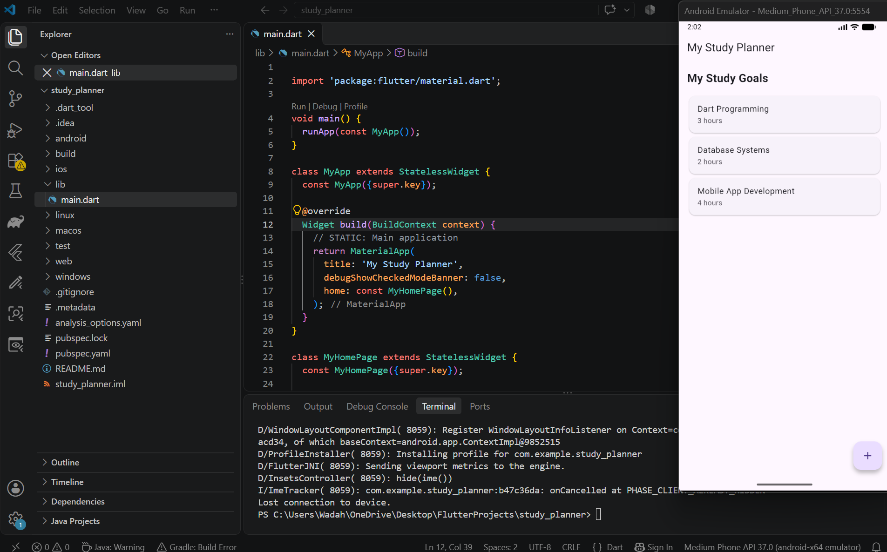
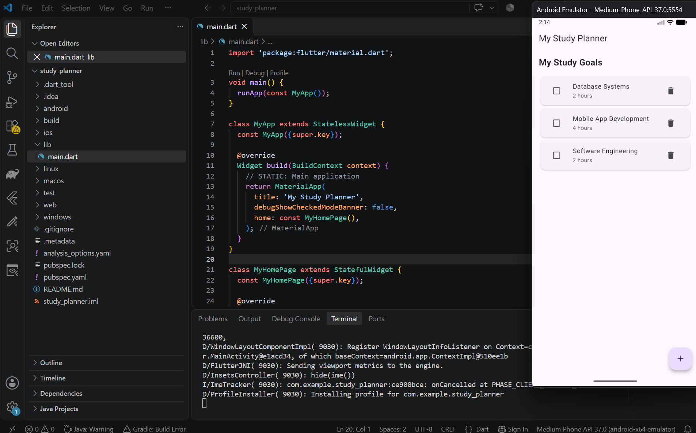
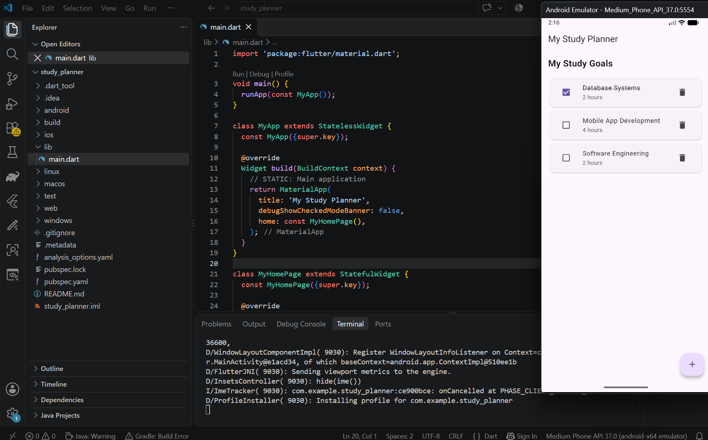

# My Study Planner

A Flutter application developed for the Mobile App Development (Dart & Flutter) course at the University of Lay Adventists of Kigali (UNILAK).

The application helps students organize study goals by subject, planned study hours, and completion status.

## Group Members

| Registration Number |
|---|
| 26188/2024 |
| 25448/2024 |
| 23307/2023 |
| 19402/2022 |
| 16451/2020 |

## Technologies Used

- Flutter
- Dart
- Material Design
- Visual Studio Code

## Completed Phases

### Phase 1 — Static Screen

- Created the initial application interface.
- Used MaterialApp and Scaffold.
- Added an AppBar titled "My Study Planner".
- Displayed a heading and three hard-coded study-goal cards.
- Added a FloatingActionButton.
- Used a StatelessWidget.

### Phase 2 — Working List

- Converted the home screen into a StatefulWidget.
- Stored study goals in a List of Maps.
- Used ListView.builder to display goals dynamically.
- Added functionality to add sample goals.
- Added functionality to mark goals as completed.
- Added functionality to delete goals.
- Used setState() to update the interface.
- Displayed completed goals with a strikethrough.

## Screenshots

### Phase 1 — Static Screen

### Phase 2 — Before Toggling

### Phase 2 — After Toggling

## Project Progress

| Phase | Description | Status |
|---|---|---|
| 1 | Static Screen | Completed |
| 2 | Working List | Completed |
| 3 | Statistics & Cards | Not Started |
| 4 | Second Screen | Not Started |
| 5 | Database Persistence | Not Started |

## Repository

[GitHub Repository](https://github.com/WadahMuzamil/study-planner-group-22)

## Institution

University of Lay Adventists of Kigali (UNILAK)

**Course:** Mobile App Development (Dart & Flutter)
